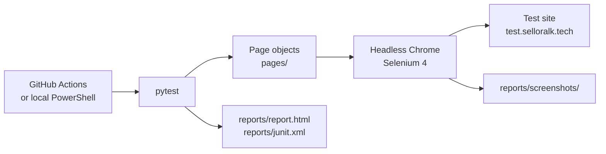

# Audit UI Test Suite (Selenium)

End-to-end UI tests for the Audit log, Reports and Exports pages of the Sellora web app, written in Python with Selenium 4 and pytest.


[](https://github.com/Team-Sellora/sellora-audit/actions/workflows/selenium.yml?query=branch%3Atest%2Fselenium-audit)

## Contents

1. [Overview](#1-overview)
2. [Tech stack and design](#2-tech-stack-and-design)
3. [Project structure](#3-project-structure)
4. [Test cases](#4-test-cases)
5. [Results summary](#5-results-summary)
6. [Defect found (DEF-01)](#6-defect-found-def-01)
7. [CI pipeline](#7-ci-pipeline)
8. [How to run locally](#8-how-to-run-locally)
9. [Evidence](#9-evidence)
10. [Limitations and next steps](#10-limitations-and-next-steps)

## 1. Overview

**What is tested.** Three pages of the Sellora Management Console that are backed by this Audit service (Epic E7), on the shared test site `http://test.selloralk.tech`:

| Page | Story | What the tests check |
|------|-------|----------------------|
| Audit log | US-E7-1 | Page heading and immutability notice, the Audit Entries table, filters and Reset, invalid input, the entry details drawer, cryptographic chain verification |
| Reports (Reporting dashboard) | US-E7-2 | Date presets, From/To dates, Compare previous period, Sales Breakdown tabs |
| Exports (My exports panel) | US-E7-3 | An Export CSV request shows up in My exports with a valid status |

Login through the identity server is also covered, because every test starts from it.

**Why UI tests.** The backend already has unit and API tests (`tests/Sellora.AuditService.Tests`). These Selenium tests add the user's view: they check that the web app calls the service correctly, shows the data, and reports errors in a way a user can understand. DEF-01 below is an example of a problem that only shows up at this level: the API contract is right, but the user gets wrong results without any message.

**Scope.** The tests are read-only. The only write is one harmless CSV export that TC-AUD-12 queues. Nothing is rebuilt, changed or deleted. The tests run as a CompanyAdmin test account, so every page and the Verify integrity panel are visible.

## 2. Tech stack and design

| Item | Use |
|------|-----|
| Python 3.12+ | Language (3.12 in the pipeline) |
| Selenium 4 | Browser automation. Selenium Manager downloads the matching ChromeDriver |
| pytest 8 | Test runner, fixtures and markers (`smoke`, `audit`, `reports`, `exports`, `negative`) |
| pytest-html | Self-contained HTML report with a screenshot for every test |
| Google Chrome | Headless by default (`--headless=new`, 1920x1080) |

**Design choices**

- **Page Object Model.** Locators and page actions live in `pages/`; tests only call page methods and assert. Locators prefer `data-testid`, `aria-label` and visible label text over CSS layout.
- **Explicit waits only.** Every wait is a `WebDriverWait` on a condition (table loaded, drawer ready, dates changed, export listed). There are no fixed sleeps.
- **A screenshot for every test.** A hook in `conftest.py` saves `reports/screenshots/<test>-<outcome>.png` after each test (or after a failed setup) and adds it to the HTML report.
- **Lessons from the Delivery suite, applied from the first commit:**
  - *Navigation by the sidebar.* The web app keeps the login token in memory only, so a full page load from a typed URL would lose it. After login, every page is opened by clicking its sidebar link.
  - *Robust login.* Each login step waits up to `LOGIN_TIMEOUT` seconds (default 60). After submit, the login accepts either the app shell (sidebar) or a consent page, and the whole login is retried once if a step times out.
  - *Stale-element-safe reads.* `BasePage.read()` retries a read when React re-renders the element, and the waits ignore `StaleElementReferenceException`.



## 3. Project structure

```text
selenium-tests/
├── conftest.py              # Chrome driver fixture, base_url fixture, screenshot hook
├── pytest.ini               # test path, HTML report options, markers
├── requirements.txt         # selenium, pytest, pytest-html
├── .gitignore               # ignores reports/, caches and .venv/
├── test-cases.md            # test case table with steps, expected and actual results
├── defects.md               # defects found by the suite (DEF-01)
├── README.md                # this report
├── docs/
│   └── images/              # evidence screenshots used in this README
├── pages/
│   ├── __init__.py
│   ├── base_page.py         # shared waits, stale-safe reads, sidebar navigation, error banner checks
│   ├── login_page.py        # identity server login with LOGIN_TIMEOUT, consent page and one retry
│   ├── audit_log_page.py    # Audit log: filters, table, entry drawer, Verify integrity
│   ├── reports_page.py      # Reporting dashboard: presets, dates, compare toggle, breakdown tabs, export
│   └── my_exports_panel.py  # My exports panel: open, load, read export rows
├── tests/
│   ├── test_login.py        # TC-AUD-01
│   ├── test_audit_log.py    # TC-AUD-02 to TC-AUD-07
│   ├── test_reports.py      # TC-AUD-08 to TC-AUD-11
│   └── test_exports.py      # TC-AUD-12
└── reports/                 # created by each run, not committed: report.html, junit.xml, screenshots/, downloads/
```

The pipeline is defined in [`.github/workflows/selenium.yml`](../.github/workflows/selenium.yml).

## 4. Test cases

Full steps and expected results are in [test-cases.md](test-cases.md). Durations are from the JUnit reports of the latest local run and of the pipeline run (section 5).

| ID | Title | Area | Type | Result | Local (s) | Pipeline (s) |
|----|-------|------|------|--------|----------:|-------------:|
| TC-AUD-01 | Login succeeds | Login | Functional | Passed | 12.9 | 5.4 |
| TC-AUD-02 | Audit log page opens | Audit log | Navigation | Passed | 20.4 | 29.2 |
| TC-AUD-03 | Audit Entries table structure | Audit log | Functional | Passed | 15.1 | 7.5 |
| TC-AUD-04 | Event Type filter and Reset | Audit log | Functional | Passed | 16.3 | 7.9 |
| TC-AUD-05 | Non-UUID Aggregate ID | Audit log | Negative | XFail (DEF-01) | 15.1 | 7.0 |
| TC-AUD-06 | Audit entry details drawer | Audit log | Functional | Passed | 16.2 | 8.1 |
| TC-AUD-07 | Verify chain integrity | Audit log | Functional | Passed | 15.6 | 8.1 |
| TC-AUD-08 | Reports page opens | Reports | Navigation | Passed | 13.7 | 7.6 |
| TC-AUD-09 | Date presets | Reports | Functional | Passed | 13.5 | 6.6 |
| TC-AUD-10 | Compare previous period | Reports | Functional | Passed | 13.5 | 6.2 |
| TC-AUD-11 | Sales Breakdown tabs | Reports | Functional | Passed | 16.6 | 7.7 |
| TC-AUD-12 | Export CSV to My exports | Exports | Export | Passed | 19.4 | 10.4 |

Each test logs in with a fresh browser, so every duration includes the login.

## 5. Results summary

| Run | Where | Date | Passed | Failed | XFail | Total time |
|-----|-------|------|-------:|-------:|------:|-----------:|
| Latest local run | Windows 11, Python 3.14, Chrome | 2026-10-22 | 11 | 0 | 1 | 191.0 s (3 min 11 s) |
| Pipeline run [#39625203542](https://github.com/Team-Sellora/sellora-audit/actions/runs/39625203542) | GitHub Actions `ubuntu-latest`, Python 3.12, headless Chrome | 2026-10-21 | 11 | 0 | 1 | 112.9 s (1 min 53 s) |

- **Pass rate:** 11 of 12 tests passed (91.7 %). The 12th test, TC-AUD-05, failed as expected because of a known product defect. There were no unexpected failures.
- **Pipeline:** the run on commit `48dfd8b` finished with conclusion *success*; every step passed, including *Run Selenium tests* and *Upload report*.
- JUnit XML has no separate xfail count, so `junit.xml` lists TC-AUD-05 as `skipped` with type `pytest.xfail`.

**How the xfail came about**

1. In the first local run (2026-10-21), TC-AUD-05 **failed**. Its screenshot, [`def-01-invalid-aggregate-id.png`](docs/images/def-01-invalid-aggregate-id.png), shows the value `not-a-valid-uuid` in Aggregate ID, the "Timeline mode active" notice, and the table still listing all 116 entries.
2. The failure was investigated against the API spec and the backend tests. The test was correct and the product was wrong, so this is a real defect (DEF-01, section 6).
3. The test was **kept unchanged** rather than weakened to match the wrong behaviour. Its assertions still describe the correct behaviour, and it is marked as a known defect:

   ```python
   @pytest.mark.xfail(strict=True, reason="Known defect: non-UUID Aggregate ID is ignored and all entries are shown (see defects.md)")
   ```

4. Because of `strict=True`, the test cannot silently pass. When DEF-01 is fixed, the test passes, pytest reports it as **XPASS(strict)** and the run fails. That is the signal to remove the marker, so the test goes back to being a normal regression test.

## 6. Defect found (DEF-01)

**Non-UUID Aggregate ID filter is silently ignored**

| Field | Value |
|-------|-------|
| ID | DEF-01 |
| Found by | TC-AUD-05 (`test_invalid_aggregate_id_is_handled`) |
| Page | Audit log, filter form |
| Environment | `http://test.selloralk.tech`, CompanyAdmin test account, Chrome |
| Severity | **Medium.** The user gets wrong search results with no warning, which can mislead an audit search. No data is lost or exposed, and entering a valid UUID works. |
| Status | Open. Tracked in the suite as `xfail(strict=True)` |

**Steps to reproduce**

1. Log in and open **Audit log** from the sidebar.
2. Type `not-a-valid-uuid` in **Aggregate ID**.
3. Click **Apply filters**.

**Expected result.** A malformed Aggregate ID is rejected. The API spec [docs/US-E7-1.md](../docs/US-E7-1.md) says that for `GET /api/audit` "a malformed value → 400", and the backend test `ApiSecurityTests.A_malformed_filter_is_a_bad_request` expects `400 Bad Request` for `aggregateId=not-a-guid`. The web app should show that as its error banner ("Unable to load audit entries"), or show no results.

**Actual result.** No error banner or message is shown. "Timeline mode active" appears, but the filter is dropped and the table lists all entries (116 total, the same as with no filter). The user is not told that the filter was ignored.

**Evidence**


*TC-AUD-05, first local run: `not-a-valid-uuid` is in Aggregate ID and "Timeline mode active" is shown, but Audit Entries still shows 116 total.*

**Notes.** The web form sends the value without checking it, and its placeholder says "UUID or reference", while the API only accepts a GUID for `aggregateId`.

**Suggested fix**

- Validate Aggregate ID in the web filter form and show an inline message when it is not a UUID, or
- make sure the 400 from the backend reaches the page and is shown in the error banner instead of the filter being dropped.

When the fix is deployed, remove the `xfail` marker from TC-AUD-05 (section 5).

## 7. CI pipeline

Workflow: [`.github/workflows/selenium.yml`](../.github/workflows/selenium.yml), name **Selenium UI tests (Audit)**.

| Item | Value |
|------|-------|
| Triggers | `push` to `test/selenium-audit`, and manual run (`workflow_dispatch`) only |
| Runner | `ubuntu-latest`, timeout 25 minutes |
| Working directory | `selenium-tests` |
| Target | `BASE_URL=http://test.selloralk.tech` |
| Secrets | `SELLORA_TEST_USER`, `SELLORA_TEST_PASSWORD` (mapped to `TEST_USER` and `TEST_PASSWORD`) |
| Artifact | `selenium-audit-report` (the whole `selenium-tests/reports/` folder) |

**Steps**

1. `actions/checkout@v4`
2. `actions/setup-python@v5` with Python 3.12
3. Install dependencies: `pip install -r requirements.txt`
4. Run Selenium tests: `pytest --html=reports/report.html --self-contained-html --junitxml=reports/junit.xml`
5. Upload report: `actions/upload-artifact@v4`. This runs with `if: always()`, so the report is uploaded even when tests fail.

The runner already has Google Chrome, and Selenium Manager gets the matching driver, so no driver setup step is needed.

**Secrets.** Add them under *Settings → Secrets and variables → Actions* as repository secrets. They must be the login of a CompanyAdmin test account on the test site.

**Download the report**

- In the browser: *Actions → Selenium UI tests (Audit) → the run → Artifacts → selenium-audit-report*. Unzip it and open `report.html`.
- With the GitHub CLI:

  ```powershell
  gh run download <run-id> --repo Team-Sellora/sellora-audit --name selenium-audit-report --dir selenium-audit-report
  ```

The artifact holds `report.html` (with screenshots embedded), `junit.xml` and `screenshots/`.

## 8. How to run locally

Needs Google Chrome and Python 3.12 or later. Commands are for Windows PowerShell, run from the repository root.

```powershell
cd selenium-tests
py -3.12 -m venv .venv
.\.venv\Scripts\python -m pip install -r requirements.txt
```

**Environment variables**

| Name | Default | Purpose |
|------|---------|---------|
| `BASE_URL` | `http://test.selloralk.tech` | Site under test |
| `TEST_USER` | (required) | Login of a CompanyAdmin test account |
| `TEST_PASSWORD` | (required) | Password of that account |
| `HEADLESS` | `1` | `0` opens a visible browser window |
| `LOGIN_TIMEOUT` | `60` | Seconds to wait for each login step |

```powershell
$env:TEST_USER = "<test account login>"
$env:TEST_PASSWORD = Read-Host "Password"
```

**Headless run (default)**

```powershell
.\.venv\Scripts\python -m pytest --junitxml=reports/junit.xml
```

**Headed run (watch the browser)**

```powershell
$env:HEADLESS = "0"
.\.venv\Scripts\python -m pytest --junitxml=reports/junit.xml
Remove-Item Env:HEADLESS
```

**Run part of the suite**

```powershell
.\.venv\Scripts\python -m pytest -m audit
.\.venv\Scripts\python -m pytest tests/test_reports.py
```

**Output**

| Path | Content |
|------|---------|
| `reports/report.html` | Self-contained HTML report with a screenshot under each test |
| `reports/junit.xml` | JUnit XML (only when `--junitxml` is given) |
| `reports/screenshots/` | One PNG per test, named `<test>-<outcome>.png` |
| `reports/downloads/` | Files downloaded by the browser during the run |

## 9. Evidence

Screenshots were taken by the suite itself on the test site. Apart from DEF-01, all of them are from the latest local run.


*TC-AUD-02: the Audit log page opened from the sidebar, with the immutability description, Cryptographic Chain Verification, the filter form and the Audit Entries table (116 total).*


*TC-AUD-07: after Verify integrity, "Chain integrity verified" shows that all 116 sequential entries have valid hash continuity.*


*TC-AUD-11: the Reporting dashboard with the Last 90 days preset, the summary cards, Daily Sales Trend and Orders by Status charts, and the Sales Breakdown tabs below.*


*TC-AUD-12: after Export CSV, a new "Sales breakdown" CSV export is listed in My exports with status Ready.*


*TC-AUD-05 (DEF-01): with `not-a-valid-uuid` in Aggregate ID, the table still shows all 116 entries and no message.*

The full HTML report and JUnit XML for each run are in `reports/` locally and in the `selenium-audit-report` artifact of the pipeline run.

## 10. Limitations and next steps

**Limitations**

- The suite depends on the shared test site and its data. Some checks adapt to the data: TC-AUD-06 is skipped if there are no audit entries, TC-AUD-07 if the account cannot verify, and TC-AUD-11 if there are no confirmed sales in the last 90 days. Downtime or data changes on the test site can affect results.
- All tests run as one CompanyAdmin account, so role-based behaviour is not covered yet.
- Only Google Chrome is tested.
- TC-AUD-12 adds one export to the account's My exports list on each run.

**Next steps**

1. Fix DEF-01 and remove the `xfail` marker from TC-AUD-05.
2. Add role-based tests: an Area Manager sees only entries in their scope, and a Sales Rep cannot open the Audit log.
3. Run the suite on more browsers (Firefox, Edge), for example as a matrix in the pipeline.
